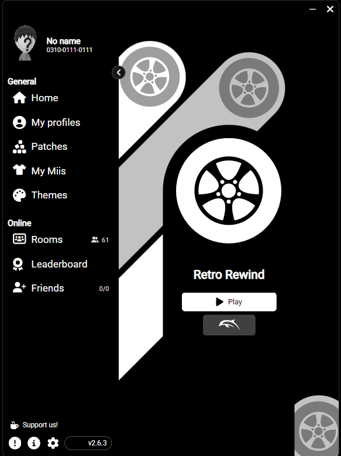
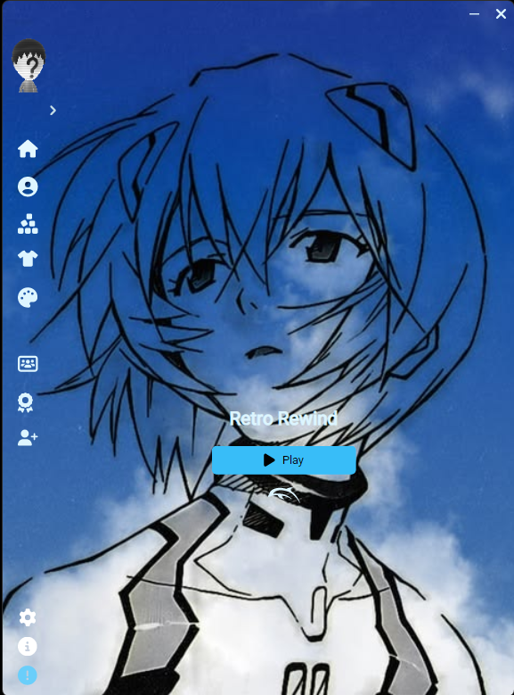
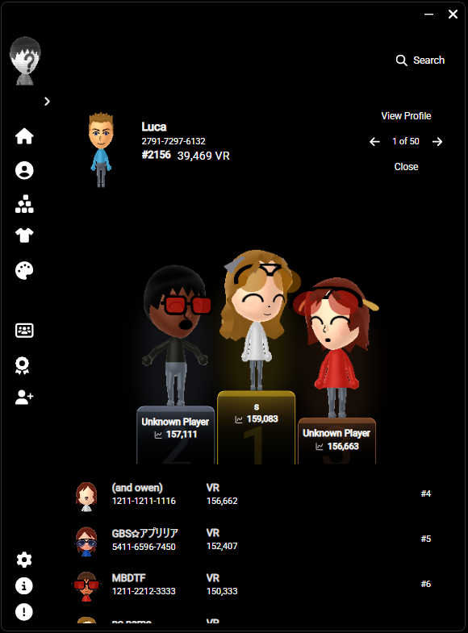
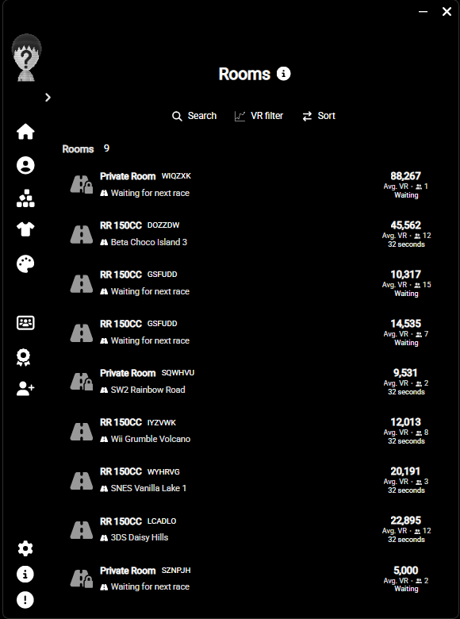
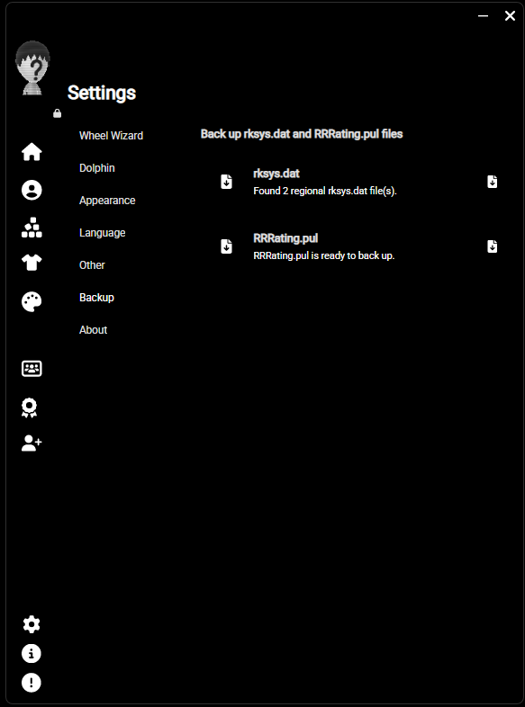
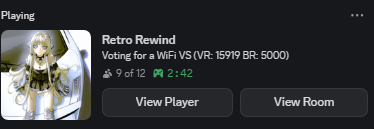

# BetterWheelWizard

A community version of [WheelWizard](https://github.com/TeamWheelWizard/WheelWizard) with a cleaner interface and additional Retro Rewind tools.

## Download

| Platform | Download |
| --- | --- |
| Windows x64 | [BetterWheelWizard.exe](https://github.com/imlucaa/BetterWheelWizard/releases/latest/download/BetterWheelWizard.exe) |
| Linux x64 | [BetterWheelWizard_Linux](https://github.com/imlucaa/BetterWheelWizard/releases/latest/download/BetterWheelWizard_Linux) |
| Linux ARM64 | [BetterWheelWizard_ARM64_Linux](https://github.com/imlucaa/BetterWheelWizard/releases/latest/download/BetterWheelWizard_ARM64_Linux) |

All builds are standalone single files. No installer or separate .NET installation is required.

## Features

- Leaderboard search
- Live room list
- Mii downloader and editor
- Custom themes and backgrounds
- Save and rating backups
- Discord status with your own image

## FAQ

### How do I show Retro Rewind on my Discord profile with my own image?

1. Open [discord.com/developers/applications](https://discord.com/developers/applications), click **New Application** and name it **Retro Rewind**.
2. Under **Rich Presence > Art Assets**, upload a square image and give it a name, for example `my_image`. Save, then wait a few minutes.
3. In BetterWheelWizard open **Settings > Discord RPC** and press **Run setup**.
4. Paste your **Application ID** (from General Information), pick your image, and press **Finish**.
5. Restart Dolphin and start the game.

Use the **Check setup** button if the image does not show. A new image can take up to 20 minutes to appear.

### Why does it only show for some people?

The View Player and View Room buttons are only shown to other people looking at your profile, not to you. View Room opens the room in Wheel Wizard, so it only works for people who have it open.

### Does it change the Retro Rewind pack?

No. The game files stay untouched, so online play works as normal. BetterWheelWizard reads the game screen from Dolphin and sends the status to Discord itself.

## Screenshots

<p align="center">
  
  
  
</p>
<p align="center">
  
  
  
</p>

## Build from source

BetterWheelWizard requires the .NET 10 SDK.

```sh
dotnet test WheelWizard.sln --configuration Release
dotnet build WheelWizard.sln --configuration Release
```

## License

BetterWheelWizard is an unofficial fork of WheelWizard and is licensed under the [GNU GPL v3](LICENSE).
