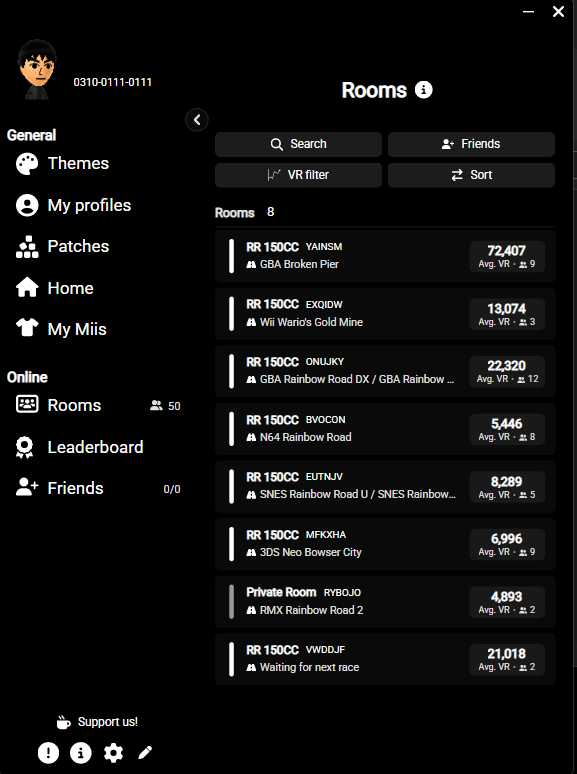
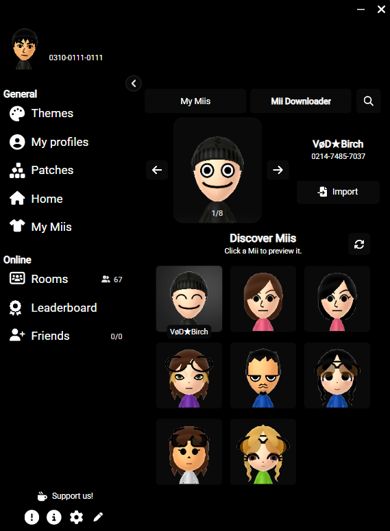
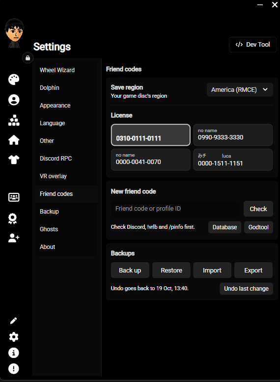
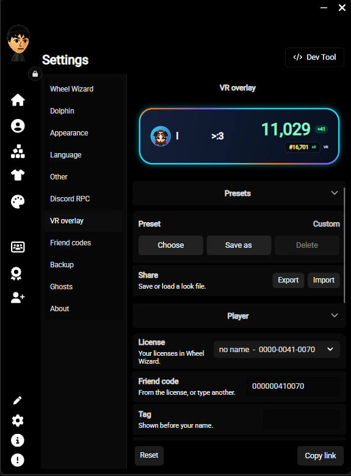
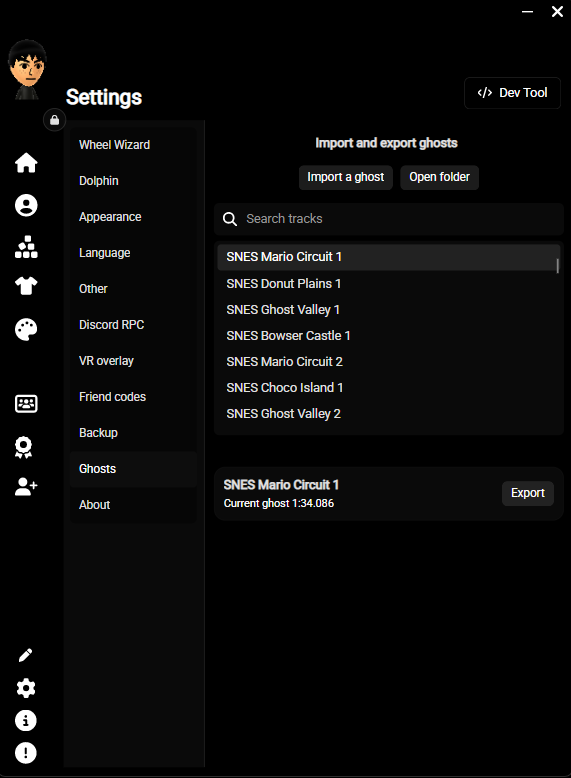
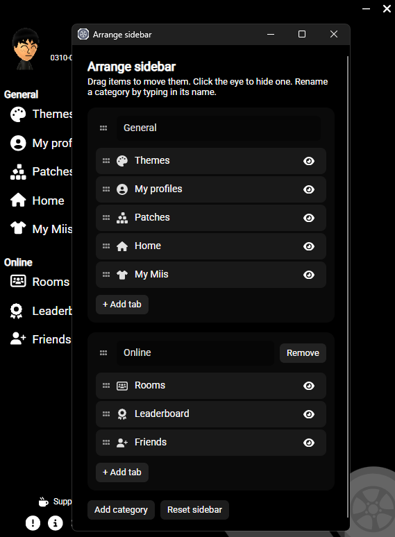
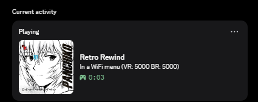

# BetterWheelWizard

Quality-of-life upgrades for [WheelWizard](https://github.com/TeamWheelWizard/WheelWizard).

## Download

| Platform | Download |
| --- | --- |
| Windows x64 | [BetterWheelWizard.exe](https://github.com/imlucaa/BetterWheelWizard/releases/latest/download/BetterWheelWizard.exe) |
| Linux x64 | [BetterWheelWizard_Linux](https://github.com/imlucaa/BetterWheelWizard/releases/latest/download/BetterWheelWizard_Linux) |
| Linux ARM64 | [BetterWheelWizard_ARM64_Linux](https://github.com/imlucaa/BetterWheelWizard/releases/latest/download/BetterWheelWizard_ARM64_Linux) |

All builds are standalone single files. No installer or separate .NET installation is required.

## Features

- **Leaderboard**: search for any player.
- **Rooms**: filter the room list and sort it by highest or lowest VR.
- **Miis**: download a Mii with the player's friend code or Mii name.
- **Themes**: make your own themes and use your own images as backgrounds.
- **RKSYS editor**: see if a friend code is free, then claim it in game.
- **VR overlay**: show your VR on stream with an OBS overlay.
- **Custom Discord status**: put your own image on your Discord status instead of the default one.
- **Ghosts**: import a ghost and the track is found for you. You can export ghosts too.
- **Backup**: back up your save and rating files and import them later.
- **Sidebar**: press the pen icon to add pages, reorder them, make categories, or hide what you don't use.
- **WiiCompiled**: the Discord status and themes work there too.

## FAQ

### How do I show Retro Rewind on my Discord profile with my own image?

1. Open [discord.com/developers/applications](https://discord.com/developers/applications), click **New Application** and name it **Retro Rewind**.
2. Under **Rich Presence > Art Assets**, upload a square image and give it a name, for example `my_image`. Save, then wait a few minutes.
3. In BetterWheelWizard open **Settings > Discord RPC** and press **Run setup**.
4. Paste your **Application ID** (from General Information), pick your image, and press **Finish**.
5. Restart Dolphin and start the game.

Use the **Check setup** button if the image does not show. A new image can take up to 20 minutes to appear.

### Why does it only show for some people?

The View Player and View Room buttons are only shown to other people looking at your profile, not to you. View Room opens the room in Wheel Wizard, so it only works for people who have it open.

### Does it change the Retro Rewind pack?

No. The game files stay untouched, so online play works as normal. BetterWheelWizard reads the game screen from Dolphin and sends the status to Discord itself.

## Screenshots

<table>
  <tr>
    <td align="center" width="33%"><br /><sub><b>Home</b></sub></td>
    <td align="center" width="33%"><br /><sub><b>Leaderboard</b></sub></td>
    <td align="center" width="33%"><br /><sub><b>Rooms</b></sub></td>
  </tr>
  <tr>
    <td align="center" width="33%"><br /><sub><b>Mii downloader</b></sub></td>
    <td align="center" width="33%"><br /><sub><b>Themes</b></sub></td>
    <td align="center" width="33%"><br /><sub><b>RKSYS editor</b></sub></td>
  </tr>
  <tr>
    <td align="center" width="33%"><br /><sub><b>VR overlay</b></sub></td>
    <td align="center" width="33%"><br /><sub><b>Ghosts</b></sub></td>
    <td align="center" width="33%"><br /><sub><b>Backup</b></sub></td>
  </tr>
  <tr>
    <td align="center" width="33%"><br /><sub><b>Sidebar editor</b></sub></td>
    <td align="center" width="33%"><br /><sub><b>Discord settings</b></sub></td>
  </tr>
</table>

<p align="center">
  <br />
  <sub><b>Your own image on Discord</b></sub>
</p>

## Build from source

BetterWheelWizard requires the .NET 10 SDK.

```sh
dotnet test WheelWizard.sln --configuration Release
dotnet build WheelWizard.sln --configuration Release
```

## License

BetterWheelWizard is an unofficial fork of WheelWizard and is licensed under the [GNU GPL v3](LICENSE).
